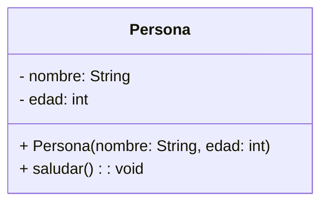
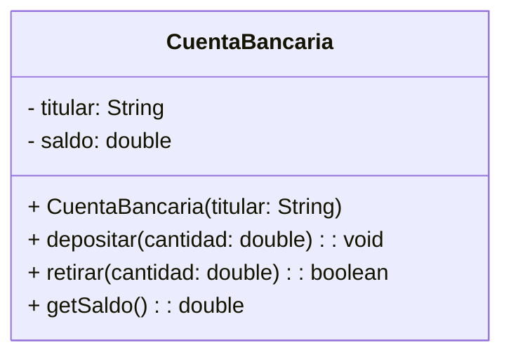

### 1. UML vs Código Java

**UML (Diagrama de Clases)** es la representación visual de una clase.  
**Código Java** es la implementación real.

**Correspondencia básica:**

| Elemento UML       | Código Java                     |
| ------------------ | ------------------------------- |
| Nombre de la clase | `public class Persona`          |
| Atributos          | `private String nombre;`        |
| Métodos            | `public void saludar() { ... }` |
| Visibilidad `+`    | `public`                        |
| Visibilidad `-`    | `private`                       |
| Visibilidad `#`    | `protected`                     |
| Visibilidad `~`    | package-private (default)       |
| Constructor        | `public Persona(...)`           |

**Ejemplo UML simple:**



**Ejercicio 1 – UML → Código**  
Traduce el siguiente diagrama UML a código Java completo:



---

### 2. Paquetes

Los paquetes organizan las clases y evitan conflictos de nombres.

**Reglas:**

- Nombre en minúsculas: `com.empresa.proyecto`
- La primera línea del archivo debe ser: `package com.empresa.proyecto;`
- Para usar clases de otro paquete: `import com.empresa.proyecto.Clase;`

**Estructura recomendada de un proyecto:**

```
src/
 └── com/
     └── miapp/
         ├── modelo/
         │    └── Persona.java
         ├── servicio/
         │    └── PersonaService.java
         └── Main.java
```

**Ejercicio 2 – Paquetes**  
Crea la siguiente estructura:

- Paquete `modelo` → clase `Producto`
- Paquete `main` → clase `Main` que use `Producto`

---

### 3. Modificadores de Acceso

| Modificador    | Misma clase | Mismo paquete | Subclase (otro paquete) | Todo el mundo |
| -------------- | ----------- | ------------- | ----------------------- | ------------- |
| `private`      | Sí          | No            | No                      | No            |
| default (nada) | Sí          | Sí            | No                      | No            |
| `protected`    | Sí          | Sí            | Sí                      | No            |
| `public`       | Sí          | Sí            | Sí                      | Sí            |

**Regla de oro de encapsulación:**  
Atributos → `private`  
Métodos de acceso → `public` (getters/setters)  
Métodos internos → `private` o `protected`

**Ejercicio 3 – Modificadores**  
Crea una clase `Empleado` con:

- Atributos `private`: nombre, salario
- Constructor `public`
- Getter y Setter `public` para el nombre
- Getter `public` y Setter `protected` para el salario
- Método `private` que calcule el bono (10% del salario)
- Método `public` que muestre el salario + bono

---

### 4. Clases Estándar importantes

#### String vs StringBuilder

- `String` → **inmutable** (cada modificación crea un nuevo objeto)
- `StringBuilder` → **mutable** (más eficiente cuando hay muchas concatenaciones)

#### Math

Clase utilitaria con métodos estáticos: `Math.max()`, `Math.min()`, `Math.pow()`, `Math.random()`, `Math.round()`, etc.

#### List e ArrayList

```java
import java.util.List;
import java.util.ArrayList;

List<String> nombres = new ArrayList<>();
nombres.add("Ana");
nombres.add("Luis");
nombres.get(0);
nombres.size();
nombres.remove(1);
```

**Ejercicio 4 – StringBuilder + Math + ArrayList**  
Crea una clase `GeneradorCodigos` que:

1. Genere 10 códigos aleatorios de 6 caracteres (letras + números) usando `StringBuilder` y `Math.random()`
2. Los guarde en un `ArrayList<String>`
3. Imprima todos los códigos generados

---

### 5. I/O Avanzado

**Lectura eficiente:**

```java
import java.io.BufferedReader;
import java.io.InputStreamReader;

BufferedReader br = new BufferedReader(new InputStreamReader(System.in));
String linea = br.readLine();
int numero = Integer.parseInt(linea);
```

**Escritura:**

```java
System.out.println(...);           // PrintStream
System.err.println(...);           // Para errores
```

**Ejercicio 5 – I/O Avanzado**  
Crea un programa que:

1. Lea el nombre de un archivo de texto (usando `BufferedReader`)
2. Lea cuántas líneas tiene el archivo
3. Muestre las primeras 5 líneas del archivo
4. Maneje posibles excepciones (`IOException`, `FileNotFoundException`)

---

### Ejercicios Integradores (más profundos)

#### Ejercicio 6 – Sistema de Biblioteca simple

Crea las siguientes clases respetando paquetes y modificadores:

**Paquete `modelo`:**

- `Libro` (isbn, titulo, autor, disponible)
- `Usuario` (id, nombre, librosPrestados → `List<Libro>`)

**Paquete `servicio`:**

- `BibliotecaService` con métodos:
  - `prestarLibro(Usuario, Libro)`
  - `devolverLibro(Usuario, Libro)`
  - `mostrarLibrosDisponibles()`

**Paquete `main`:**

- Clase `Main` que cree varios libros y usuarios y simule préstamos.

#### Ejercicio 7 – Validador de Contraseñas

Crea una clase `ValidadorPassword` que:

- Reciba una contraseña por consola (`BufferedReader`)
- Use `StringBuilder` para construir un mensaje de errores
- Verifique:
  - Mínimo 8 caracteres
  - Al menos una mayúscula
  - Al menos un número
  - Al menos un carácter especial
- Use `Math` si necesitas generar una contraseña segura de ejemplo
