# Guía de Laboratorio

## Evolución de un sistema de estudiantes en Java

> [!INFO] Ficha Técnica de la Práctica
> * **Asignatura:** Programación Orientada a Objetos
> * **Lenguaje:** Java
> * **Nivel:** Principiantes
> * **Enfoque Pedagógico:** Evolución incremental guiada por requisitos, refactorización limpia y buenas prácticas de diseño.

---

# 1. Problema

Una universidad necesita desarrollar un pequeño sistema para administrar información de las personas que forman parte de la institución.

Inicialmente, el sistema solamente debe permitir registrar estudiantes.

Cada estudiante posee información básica:

* Nombre.
* Edad.
* Carrera.

A medida que el sistema evoluciona aparecen nuevas necesidades.

La universidad también necesita registrar docentes. Al mismo tiempo, el sistema comienza a incorporar más funcionalidades, por lo que algunas clases empiezan a asumir demasiadas responsabilidades.

Posteriormente se necesita almacenar la información temporalmente en memoria. Para evitar trabajar todavía con una base de datos externa, se construirá una pequeña base de datos simulada utilizando las colecciones de Java.

Finalmente, se requiere que exista una única instancia de esta base de datos en memoria para que todos los componentes del sistema trabajen sobre el mismo almacenamiento.

El sistema deberá evolucionar progresivamente hasta llegar a una estructura similar a:

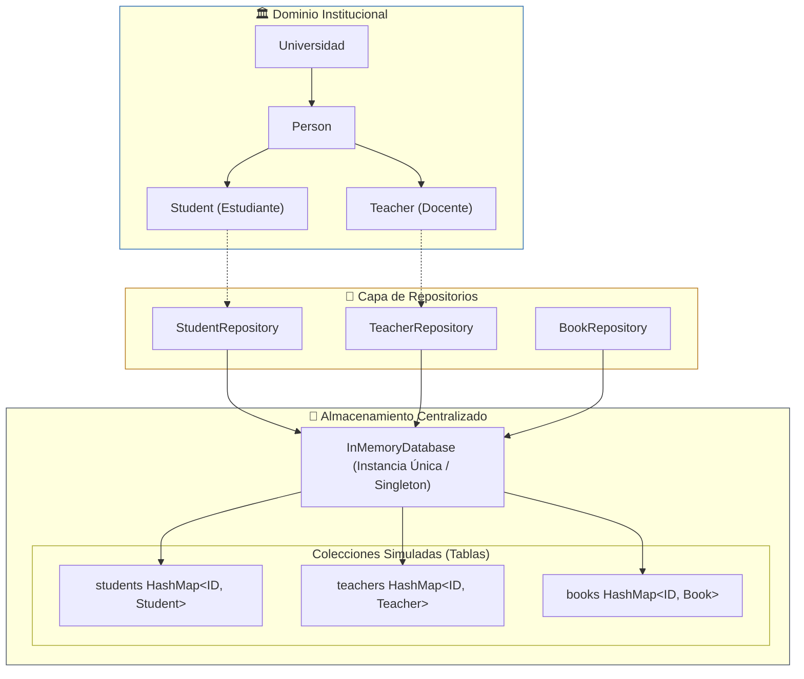

> [!NOTE] Propósito Formativo
> El propósito de la práctica no es construir un sistema completo, sino comprender cómo un programa puede mejorar progresivamente a medida que aparecen nuevos requisitos.

---

# 2. Objetivos

Al finalizar la práctica, el estudiante deberá ser capaz de:

1. Crear clases y objetos en Java.
2. Aplicar encapsulación mediante atributos privados y métodos de acceso.
3. Comprender y utilizar herencia.
4. Identificar responsabilidades diferentes dentro de un sistema.
5. Comprender de manera introductoria los principios SRP y OCP.
6. Utilizar `List`, `Map` y `HashMap`.
7. Simular una base de datos utilizando estructuras de datos en memoria.
8. Comprender el propósito del patrón Singleton.
9. Analizar cómo un sistema puede evolucionar desde una solución sencilla hacia una solución mejor organizada.

---

# 3. Conceptos que se trabajarán

La práctica se desarrollará siguiendo esta secuencia:

```text
1. Student
   ↓
2. Encapsulación
   ↓
3. Person → Student / Teacher
   ↓
4. Separación de responsabilidades
   ↓
5. Extensión del sistema + almacenamiento en memoria
   ↓
6. Singleton
```

La práctica se concentra principalmente en:

| Categoría | Conceptos Abordados |
| :--- | :--- |
| **POO** | Clases y objetos, Encapsulación, Herencia |
| **Principios de diseño** | Single Responsibility Principle (SRP), Open/Closed Principle (OCP) |
| **Colecciones** | `List`, `Map`, `HashMap` |
| **Patrón de diseño** | Singleton |

```text
POO
├── Clases y objetos
├── Encapsulación
└── Herencia

Principios de diseño
├── Single Responsibility Principle
└── Open/Closed Principle

Colecciones
├── List
├── Map
└── HashMap

Patrón de diseño
└── Singleton
```

---

# 4. Etapa 1 — Crear la clase Student

## Situación inicial

La universidad necesita registrar estudiantes.

Cada estudiante debe almacenar:

```text
Student
├── name
├── age
└── career
```

También debe ser posible mostrar su información.

En esta primera etapa no se introducirá todavía ningún concepto adicional.

El objetivo es comprender la relación entre:

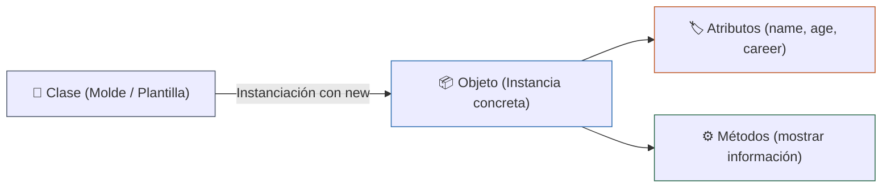

Estructura de clase inicial:

<iframe src="https://mermaid.live/embed?theme=dark&look=classic&mode=dark#pako:eNp1UrGOwyAM_RXkqVX5gmyndrmlS7eKxQouQQ1QGXI3RP33IySRwrX1Zr_n9x4yI7RBEzTQ9hjjyaJhdIqVF7nKTFzSoMknMa7jqQ55zNYb4dFRDdjMRUNv2S0yEW-hmha78Pvtb2G3Fz_B6v8aJchu4yxXN1k77OtNQ-mc2Vl1Zr2gX2YCs9YLcix6HzbjortJ9C54nA2WqB8Yi1H9jIr6BAmGrYYm8UASHLHDqYVRQeooHwIaBRr5rkAq6EO4l0m5o20VTAoP9NcQ3CrCYTAdNDfsY-6Gh8ZEyzeYKc8_usSofg" width="100%" height="480" style="border:0" loading="lazy" title="Mermaid diagram" sandbox="allow-scripts allow-same-origin allow-popups allow-popups-to-escape-sandbox"></iframe>

## Actividades

- [ ] Crear la clase `Student`.
- [ ] Crear una clase `Main`.
- [ ] Desde `Main`, crear varios objetos `Student`.
- [ ] Asignar diferentes datos a cada estudiante.
- [ ] Mostrar la información de los estudiantes.

> [!QUESTION] Preguntas de análisis
> 1. ¿Qué representa la clase `Student`?
> 2. ¿Qué representa un objeto `Student`?
> 3. ¿Cuál es la diferencia entre una clase y un objeto?
> 4. ¿Qué ocurre si existen varios objetos de la misma clase?

---

# 5. Etapa 2 — Encapsulación

## Problema

En la versión anterior, cualquier parte del programa puede acceder directamente a los atributos del estudiante.

Esto significa que el objeto no tiene control sobre su propio estado.

Por ejemplo, conceptualmente podría ocurrir:

```text
Student
│
├── name  ← puede modificarse directamente
├── age   ← puede modificarse directamente
└── career
```

Esto permite introducir información incorrecta.

Por ejemplo:

```text
age = -50
```

El sistema debería impedir ese tipo de situaciones.

<iframe src="https://mermaid.live/embed?theme=dark&look=classic&mode=dark#pako:eNqVkr1uE0EQx19ltDRBsiHBCoKTEmRiFxShwCEFHMVkd3xe-bxj7e6ZjzglHVKUlg8Bz5AG0SDhN8kLwCMwd-cDxyhIXHUz-5__zP52jpVmQypRw5yf6xH6CAe91KcO5AvFUeZxOoIHLlBWeIanqbr48AYG1kHfaZyGIkdtF-cONrpaU2DoWU868vVUPWtsys9UacsODu6v5vsv4paY7i3Ojc24DMk7lmJot3fn-2zs0GpcluOEXCQI0n1o8-h5Dt0YfWkwiIWRwxuYEexAe3tzrX-lKz1hEDFSWXLx9tOPL6fQDxENyxU1u2BDrFrclHi2-JxbwytG5Ez5-xee3yhMTej9a9jjKwnJkYxeiv8D0q2rIcmkrHEOA4qSF12g2M1oQyCsN6glVVV_hvniKybw_RsZNLC7A5v35tAjbYNMcJyqQ5Tr17On6mTVphFVRg8ZalIywiOSFXrFMsPPj-_OliF6wbmPgtVJb6px1_u0Nt4l38PG9PHUyIuJZ7MNHjB6e1REhqm3M_znG8WXOf3Z3yDkx5Rco-0OdeiyaPUVG13nDm7dvqtaKvPWqCT6glpqQn6CZaiEUhzRhFKVpMqgH6eqlaqceVxldI4hWC30xGGK7gnzpDHxXGQjlQwxDxIV1R17FmWhlpKTX5UOPjA" width="100%" height="480" style="border:0" loading="lazy" title="Mermaid diagram" sandbox="allow-scripts allow-same-origin allow-popups allow-popups-to-escape-sandbox"></iframe>

## Objetivo

Modificar la clase `Student` para proteger sus datos.

El estudiante deberá utilizar:

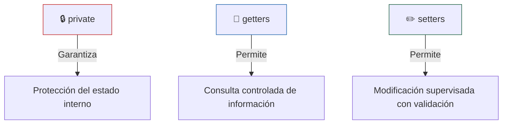

La validación debe realizarse dentro de la propia clase.

Por ejemplo, la edad no debería aceptar valores negativos.

<iframe src="https://mermaid.live/embed?theme=dark&look=classic&mode=dark#pako:eNp1UbGuwjAM_JXIE4jyA90QLG95CxvKYjUmjWhi5KQwVPw7SSkSRcWb7853lj1Aw4aghqbDGA8OraDXooPKNWLqmHpDIanhDZfaHpO4YFVATzPcZSVaWtI2KETyyWwspf_ssFqrl2ZGxon8iFqrGzvzbbGzxSEnf48XYlpoeXI_rvQzfqJn-y8YxZbvf-HMqzn3gAqsOAN1kp4q8CQeSwuDhtRSvhzUGgzKRUOloWO-jMh4d9doKA5XDCdm_zYR7m0L9Rm7mLv-ajDR9LaX5PEEsxWSIA" width="100%" height="480" style="border:0" loading="lazy" title="Mermaid diagram" sandbox="allow-scripts allow-same-origin allow-popups allow-popups-to-escape-sandbox"></iframe>

## Actividades

- [ ] Modificar los atributos de `Student`.
- [ ] Crear los métodos necesarios para consultar y modificar los datos.
- [ ] Agregar validaciones sencillas.
- [ ] Probar qué ocurre al intentar introducir datos inválidos.

> [!QUESTION] Preguntas de análisis
> 1. ¿Por qué los atributos deberían estar protegidos?
> 2. ¿Qué problema resuelve `private`?
> 3. ¿Por qué no debemos permitir que cualquier parte del programa modifique directamente los atributos?
> 4. ¿Dónde debería realizarse la validación de los datos?

> [!NOTE] Concepto clave
> La **encapsulación** consiste en proteger el estado interno de un objeto y controlar cómo ese estado puede ser consultado o modificado.

---

# 6. Etapa 3 — Introducir herencia

## Nuevo requisito

La universidad también necesita registrar docentes.

Ahora tenemos dos tipos de personas:

```text
Student
Teacher
```

Ambos comparten información:

```text
name
age
```

Pero cada uno tiene información adicional.

```text
Student
└── career
```

```text
Teacher
└── specialty
```

Si mantenemos toda la información duplicada, tendremos:

```text
Student
├── name
├── age
└── career

Teacher
├── name
├── age
└── specialty
```

Existe duplicación.

## Solución

Identificar la información común y crear una clase `Person`.

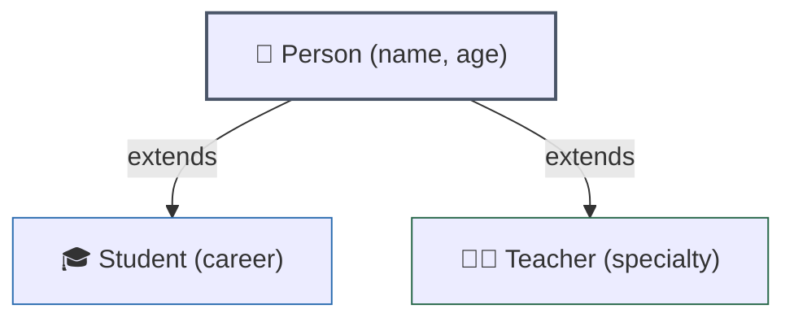

La estructura conceptual será:


<iframe src="https://mermaid.live/embed?theme=dark&look=classic&mode=dark#pako:eNqFk8FPwyAUxv8V8ry42F6miY54cZs7GpN5MlxIeVKyFhqgumXuf5d2RaXZlFP53u9976O0eyiMQKBQVNy5peLS8ppZpklYvUae0TqjyT6q3crX3iotieY1JrrSnnCZaFcS_VPgLifk2JUU3VD8ZTgh70aJscWD7ByC_7i9Kwxj085D95CeZe1bgYE9eZiCW0Q7nrvo1bPhh3Ji8W-MF-RFifZ0DNdgoXjld-Mk61g4G-aHGHv9EWm43_vPPP9-P5Tg1qMW7hQU0ydQBJ3fVRhx563ZIL14vLudrWbZcZt_KOFLOm22aU-cHZumy-XNfJUycXRkVvPZ9HoRGchAWiWAettiBjXamndb2DPwJYZPFSgDwe2GQcagMmbTK_2lqILBITg0XL8aU0cTa1pZAn3jlQu7thHc4_CbHJHDFzg2DD4" width="100%" height="480" style="border:0" loading="lazy" title="Mermaid diagram" sandbox="allow-scripts allow-same-origin allow-popups allow-popups-to-escape-sandbox"></iframe>

## Actividades

- [ ] Crear la clase `Person`.
- [ ] Mover a `Person` los atributos que sean comunes.
- [ ] Modificar `Student` para que herede de `Person`.
- [ ] Crear `Teacher` como una nueva clase que también herede de `Person`.
- [ ] Cada clase hija debe conservar sus propios datos específicos.

> [!QUESTION] Preguntas de análisis
> 1. ¿Qué información tienen en común `Student` y `Teacher`?
> 2. ¿Qué información pertenece únicamente a `Student`?
> 3. ¿Qué información pertenece únicamente a `Teacher`?
> 4. ¿Por qué no necesitamos declarar nuevamente `name` y `age` en las clases hijas?
> 5. ¿Qué representa `extends`?
> 6. ¿Qué función cumple `super`?

> [!NOTE] Concepto clave
> La **herencia** permite reutilizar características comunes de una clase existente en nuevas clases relacionadas.
> 
> En esta práctica se utilizará la herencia principalmente para **reutilizar atributos y comportamiento común**.
> 
> Todavía no se estudiarán abstracción ni polimorfismo.

---

# 7. Etapa 4 — Separación de responsabilidades

## Nuevo problema

El sistema empieza a crecer.

Ahora necesitamos guardar y mostrar información de estudiantes.

Una primera solución podría colocar muchas operaciones dentro de `Student`:

<iframe src="https://mermaid.live/embed?theme=dark&look=classic&mode=dark#pako:eNqNkk1OAzEMha8SmQ1I0wUt3cyCRSmqWCCQygqCkJu4M1EzySg_KqjqDbgCp-AI3IST4CkUWEBV7-y871nPygqU1wQlzK1fqhpDEjdjGaQTXDHPqoBtLSZen1mMUdxJeH95FtfBzyw1WIpuTGLqZ4EUhgo1ikNWb-bxSML91qur6cMINVtMU9bk0l-votc7FVftMasu3NyHBpV5e3VCkxUUmTPoEu0g-0xe-pgCBmF-OexABoxMMgbNyF47ThgY5aj21Q9Zf25NY9x_BDn9ffT0ZOnn4pzEL6g8oOGABlR8tr2l0aku--0jFFAFo6FMIVMBDXHeroWVhFRTw0tKCZxsIaGQYL1fbCaqMzdKwpodWnS33jdbk-BzVUM5Rxu5y63GRGOD_BW-JOsPgOa5EA" width="100%" height="480" style="border:0" loading="lazy" title="Mermaid diagram" sandbox="allow-scripts allow-same-origin allow-popups allow-popups-to-escape-sandbox"></iframe>

```text
Student
│
├── información del estudiante
├── mostrar información
├── guardar estudiante
├── buscar estudiante
└── eliminar estudiante
```

Esto provoca que una sola clase tenga demasiadas responsabilidades.

## Nueva idea

Separar las responsabilidades.

La estructura conceptual será:

```text
Student
   │
   └── representa al estudiante

StudentRepository
   │
   └── se encarga del almacenamiento
```

Podemos representarlo así:

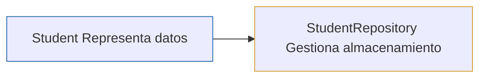

## Single Responsibility Principle

En esta etapa se introduce de manera inicial el principio:

> [!IMPORTANT] Single Responsibility Principle — SRP
> Una clase debería tener una responsabilidad principal y una razón principal para cambiar.

Por tanto:

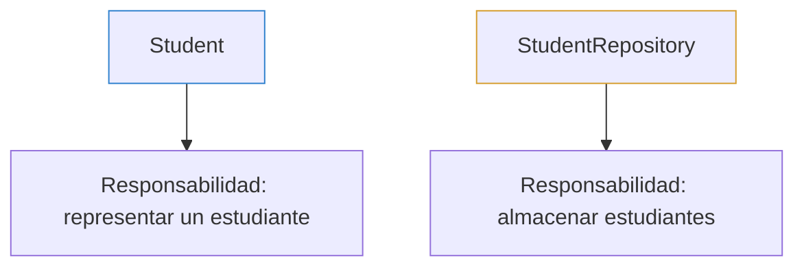

## Actividades

- [ ] Crear una clase `StudentRepository`.
- [ ] Trasladar a ella las operaciones relacionadas con el almacenamiento.
- [ ] Mantener en `Student` únicamente las responsabilidades relacionadas con el propio objeto.
- [ ] Analizar qué responsabilidades pertenecen a cada clase.

> [!QUESTION] Preguntas de análisis
> 1. ¿Qué responsabilidad tiene `Student`?
> 2. ¿Qué responsabilidad tiene `StudentRepository`?
> 3. ¿Qué problemas aparecen cuando una clase intenta hacerlo todo?
> 4. ¿Qué ventajas obtenemos al separar responsabilidades?

---

# 8. Etapa 5 — Extensión del sistema y base de datos en memoria

## Nuevo problema

La universidad necesita almacenar varios tipos de información.

Hasta este momento tenemos:

```text
students
teachers
```

Pero el sistema también podría crecer.

Por ejemplo, la universidad puede administrar:

```text
students
teachers
books
```

Más adelante podría existir:

```text
courses
classrooms
libraries
equipment
```

Por ahora no utilizaremos una base de datos real.

Vamos a construir una pequeña **base de datos en memoria** utilizando las colecciones de Java.

---

## 8.1. Primera aproximación: una colección

Una colección puede almacenar varios objetos:

```java
List<Student>
```

Conceptualmente:

```text
students
│
├── Student
├── Student
├── Student
└── Student
```

Una `List` es adecuada cuando necesitamos trabajar principalmente con una secuencia de elementos.

Sin embargo, aparece un nuevo problema:

> [!WARNING] Desafío de Búsqueda Secuencial
> ¿Cómo encontramos rápidamente un estudiante específico sin tener que recorrer toda la lista uno por uno?

Necesitamos identificarlo mediante un ID.

---

## 8.2. Utilizar HashMap

En lugar de almacenar únicamente una lista, podemos relacionar un identificador con un objeto:

```text
ID → Objeto
```

Por ejemplo:

```text
S001 → Student
S002 → Student
S003 → Student
```

Esto puede representarse mediante:

```java
Map<String, Student>
```

La estructura permite pensar en:

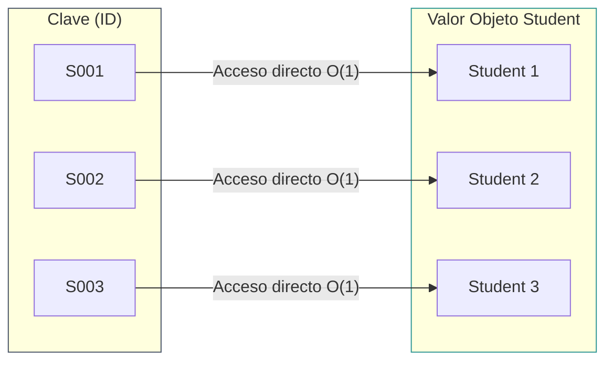

De esta forma podemos seleccionar directamente un registro mediante su identificador.

---

# 8.3. Simular tablas

Ahora llevaremos la idea un paso más allá.

En lugar de tener un único `HashMap`, tendremos varias colecciones organizadas por nombre.

La estructura conceptual será:

```text
InMemoryDatabase
│
├── "students"
│      └── Map<idStudent, Student>
│
├── "teachers"
│      └── Map<idTeacher, Teacher>
│
└── "books"
       └── Map<idBook, Book>
```

Podemos interpretar cada entrada principal como una especie de “tabla”.

```text
                InMemoryDatabase
                       │
           ┌───────────┼───────────┐
           ↓           ↓           ↓
       students     teachers      books
           │           │           │
           ↓           ↓           ↓
        HashMap      HashMap      HashMap
           │           │           │
           ↓           ↓           ↓
         S001        T001         B001
         S002        T002         B002
```

Así conseguimos una estructura semejante a:

```text
"students" → {
    "S001" → Student
    "S002" → Student
    "S003" → Student
}

"teachers" → {
    "T001" → Teacher
    "T002" → Teacher
}

"books" → {
    "B001" → Book
    "B002" → Book
}
```

---

# 8.4. Estructura general

Conceptualmente, la base de datos tendrá una estructura equivalente a:

```text
Map
 │
 ├── nombre de tabla
 │       │
 │       └── colección de registros
 │
 ├── "students"
 │       └── HashMap
 │
 ├── "teachers"
 │       └── HashMap
 │
 └── "books"
         └── HashMap
```

La idea puede representarse como:

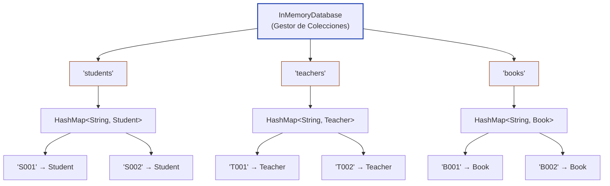

---

# 8.5. Insertar y buscar información

Las operaciones principales de nuestra base de datos pueden conceptualizarse de la siguiente forma:

```text
insert("students", "S001", student)
       │          │       │
       │          │       └── registro
       │          └─────────── ID
       └────────────────────── tabla
```

Para buscar:

```text
find("students", "S001")
      │          │
      │          └──────────── ID
      └─────────────────────── tabla
```

El flujo será:

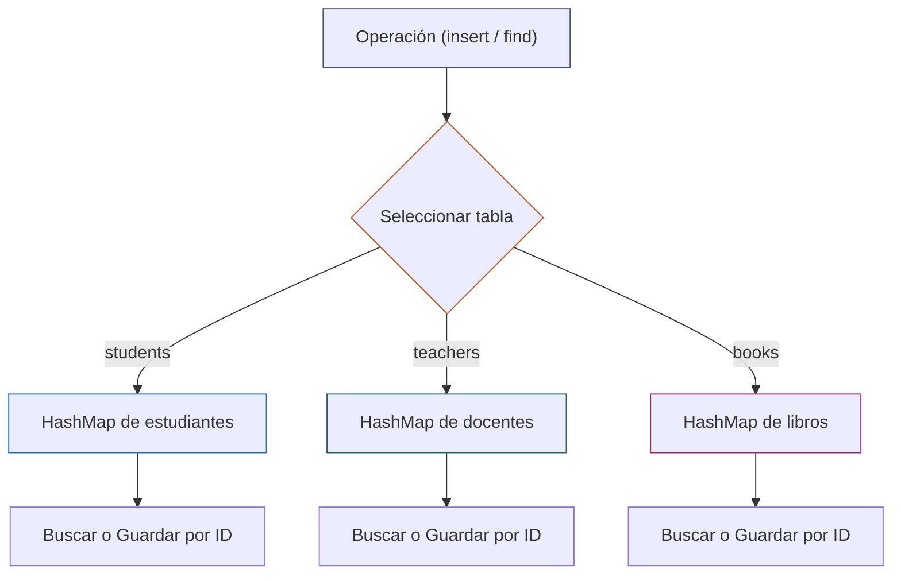

Por ejemplo, conceptualmente:

```text
find("students", "S002")
        ↓
tabla students
        ↓
HashMap
        ↓
clave S002
        ↓
Student
```

---

# 8.6. Añadir una nueva entidad

Para comprobar que nuestro diseño puede extenderse, agregaremos una nueva entidad:

```text
Book
```

Un libro puede tener:

```text
Book
├── title
├── author
└── year
```

Estructura de la clase `Book`:

<iframe src="https://mermaid.live/embed?theme=dark&look=classic&mode=dark#pako:eNp1kc8KwjAMxl-l5KQ4X2A3xTfQi9JLWGNXXFfJMkGG727XbWBFc8v3Nb_86QBVMAQlVA123cGhZfSadatiJE3tQ7ipYdHG2B6FXWuVOGnol4G91IEzx7WinoSZuLEkp5GxWqupMnO7xf1st1aP4Mw3ZZca_sXMdjbdb9A5jhgxcdpvRnKWLfLiFxRg2RkohXsqwBN7HFMYNEhNnjSUGgzyTUOhoYkXTUo6sKs0jIQ7tpcQ_ALh0Nsayis2Xcz6u0Gh-X-mJ683TSyNKQ" width="100%" height="480" style="border:0" loading="lazy" title="Mermaid diagram" sandbox="allow-scripts allow-same-origin allow-popups allow-popups-to-escape-sandbox"></iframe>

Ahora la base de datos contará con:

```text
students
teachers
books
```

El sistema debe permitir almacenar libros sin modificar la estructura fundamental de la base de datos.

---

# 8.7. Open/Closed Principle

Esta etapa introduce de forma inicial el principio:

> [!IMPORTANT] Open/Closed Principle — OCP
> Una estructura de software debería estar **abierta para su extensión**, pero **cerrada para su modificación**. Debe ser posible incorporar nuevas funcionalidades o entidades sin alterar constantemente el código previamente desarrollado y probado.

Nuestro sistema debe permitir que aparezca:

```text
students
teachers
books
```

sin tener que reconstruir toda la lógica de almacenamiento.

La idea importante es:

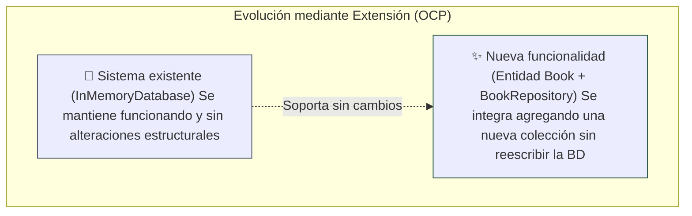

```text
Sistema existente
       ↓
se mantiene funcionando

Nueva funcionalidad
       ↓
se agrega mediante extensión
```

## Actividades

- [ ] Crear la entidad `Book`.
- [ ] Crear un repositorio para libros (`BookRepository`).
- [ ] Agregar una nueva colección dentro de la base de datos en memoria.
- [ ] Guardar libros mediante un identificador.
- [ ] Buscar libros mediante su identificador.
- [ ] Comprobar que estudiantes, docentes y libros pueden coexistir dentro de la misma base de datos.

> [!QUESTION] Preguntas de análisis
> 1. ¿Por qué utilizamos un `Map` para representar las tablas?
> 2. ¿Por qué cada tabla puede utilizar un `HashMap`?
> 3. ¿Qué ventaja tiene buscar utilizando un ID?
> 4. ¿Qué diferencia existe entre utilizar una `List` y utilizar un `HashMap`?
> 5. ¿Qué representa la clave de un `HashMap`?
> 6. ¿Qué representa el valor de un `HashMap`?
> 7. ¿Por qué nuestra estructura se parece conceptualmente a una base de datos?
> 8. ¿Qué significa que los datos están almacenados “en memoria”?
> 9. ¿Qué ocurre con los datos cuando termina el programa?
> 10. ¿Cómo podemos agregar una nueva entidad como `Book`?

---

# 9. Etapa 6 — Singleton

## Nuevo problema

Ahora tenemos una base de datos en memoria.

Pero aparece un problema.

Si diferentes partes del programa crean diferentes objetos `InMemoryDatabase`, podríamos terminar con varios almacenamientos independientes:

```text
          InMemoryDatabase 1
                 │
          ┌──────┴───────┐
          │             │
       students      teachers


          InMemoryDatabase 2
                 │
          ┌──────┴───────┐
          │             │
       students      teachers
```

Esto significa que ambos objetos podrían contener información diferente.

Queremos exactamente lo contrario:

```text
                    InMemoryDatabase
                           │
             ┌──────────────┼──────────────┐
             ↓             ↓             ↓
          Student       Teacher         Book
        Repository    Repository      Repository
```

Todos los componentes deben trabajar sobre **la misma instancia**.

---

# 9.1. Patrón Singleton

Para resolver esta situación utilizaremos el patrón de diseño **Singleton**.

La idea fundamental es:

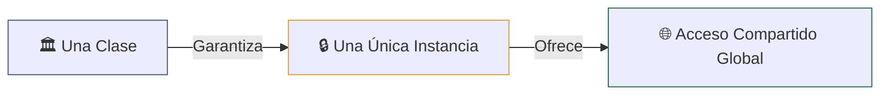

```text
Una clase
    ↓
una única instancia
    ↓
acceso compartido
```

Conceptualmente:

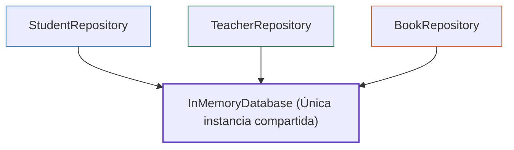

De esta manera:

```text
StudentRepository ───┐
                     │
TeacherRepository ───┼──→ InMemoryDatabase
                     │
BookRepository ──────┘
```

Todos utilizan el mismo almacenamiento.

---

# 9.2. Estructura conceptual del Singleton

La clase `InMemoryDatabase` deberá cumplir tres condiciones:

> [!IMPORTANT] Tres Condiciones Fundamentales del Patrón Singleton
> 1. **Constructor privado:** No permitir que cualquier clase cree libremente nuevas instancias (`private InMemoryDatabase()`).
> 2. **Instancia estática única:** Mantener internamente la única instancia compartida (`private static InMemoryDatabase instance`).
> 3. **Punto de acceso global:** Proporcionar una forma controlada de obtener esa instancia mediante un método estático (`public static InMemoryDatabase getInstance()`).

```text
1. No permitir que cualquier clase cree libremente
   nuevas instancias.

2. Mantener internamente la única instancia.

3. Proporcionar una forma de obtener esa instancia.
```

Estructura de la clase con el patrón aplicado:

<iframe src="https://mermaid.live/embed?theme=dark&look=classic&mode=dark#pako:eNp1kT1uwzAMha8icLJR9wKes2QIOnQrtDASo6ixJIOSAxRGfPbKtgzEDcpJ_PneI6gRVNAELagOYzxYNIxOsvQix1ITR38iF_jngAnPGEmMW3-O95gwWfU6ZX3ueEW74RP202di600jnt8f529SaZpEhjuKO-avclU_t9-Kv6F0LI5V_bLNjsibEadq9V4dG1Eyq7dlBJMKrGtxD1bv-Iv1-j-6LvQGPKABw1ZDm3igBhyxwzmFUUK6kiMJrQSNfJPQSOhCuC2V5fZWSZgVevRfIbhNhMNgrtBesIs5G3qNicrXrSOPX-EInG8" width="100%" height="480" style="border:0" loading="lazy" title="Mermaid diagram" sandbox="allow-scripts allow-same-origin allow-popups allow-popups-to-escape-sandbox"></iframe>

La representación conceptual es:

```text
InMemoryDatabase
│
├── instance
│
├── students
├── teachers
└── books
```

Y el acceso será:

```text
getInstance()
      ↓
InMemoryDatabase
      ↓
misma instancia
```

---

# 9.3. Comprobar que existe una única instancia

El estudiante deberá crear dos referencias a la base de datos.

```java
InMemoryDatabase database1 = InMemoryDatabase.getInstance();
InMemoryDatabase database2 = InMemoryDatabase.getInstance();
```

```text
database1
database2
```

Ambas deberían apuntar al mismo objeto:

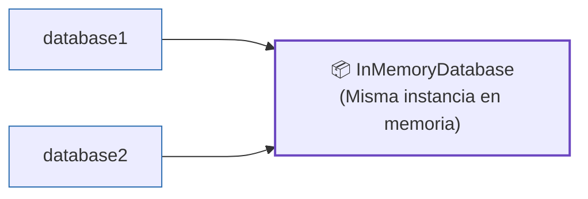

La comprobación conceptual será:

```text
database1 == database2
        ↓
       true
```

---

# 9.4. Comprobar que los datos son compartidos

Esta comprobación es todavía más importante.

El flujo será:

<iframe src="https://mermaid.live/embed?theme=dark&look=classic&mode=dark#pako:eNp1ks1O3TAQhV9l6hWVLrfQn00WSL0EVV1QpGRXeTPYQ7CI7XRso1aIh-lrdNm-WMc3N0FVIavYOd_xOZ48KBMtqUYl-lYoGGodDoxesw4gD5YcQ_HXxOuOyZGhpXvABBcpF-swZII3cIkuLKoJOTvjJvkEfVelvSgp5I6mmJxY_HhO2u6q9HO4JC-KFjNeYyI46l0YRpIor5-jrvItcQWvMkc4j36KgeZMbTT1rVILKdGPz876roHTLXQ0uJQZGeipypFW_cnJqVYb0OpjQK3WY_tO2HbXwNstuJCIs4jTXC3NwIIedoVf6S9R3OO9hK0WnwqyRRuBAowIf34FZ7C6ZgzGIRgpUlta_Df6vm4D77ZSNaQy5hfSr8fugUPu91u4ccG-kHpF2t3x00kf6j3JyAICz_cVwdJyN_-XO2C_f8oAoyCmTMT7ot9l8gl9HckrtVEDO6uazIU2yhN7rEv1oJUYeNKq0coi30lCrcYY7_Y7ZsSUnNHqURxk_l9j9IsJxzLcquYGxySrMlnMyx89Sx7_AjRC-s4" width="100%" height="480" style="border:0" loading="lazy" title="Mermaid diagram" sandbox="allow-scripts allow-same-origin allow-popups allow-popups-to-escape-sandbox"></iframe>

```text
StudentRepository
       │
       ↓
InMemoryDatabase
       │
       ↓
insert Student S001
```

Posteriormente:

```text
otro componente
       │
       ↓
InMemoryDatabase
       │
       ↓
find Student S001
```

El segundo componente debe encontrar el mismo estudiante.

Esto demuestra que todos están utilizando el mismo almacenamiento.

---

# 10. Estructura final del sistema

Al terminar la práctica, el sistema conceptual será:

```text
                           InMemoryDatabase
                                  │
                    ┌──────────────┼───────────────┐
                    ↓             ↓             ↓
                students       teachers        books
                    │             │             │
                    ↓             ↓             ↓
                 HashMap        HashMap        HashMap
                    │             │             │
                    ↓             ↓             ↓
                 S001           T001           B001
                 S002           T002           B002
```

La relación entre las entidades y sus repositorios será:

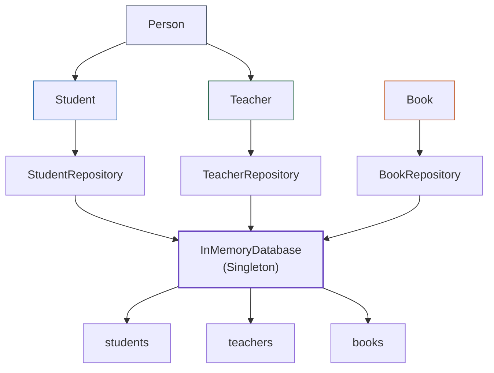

<iframe src="https://mermaid.live/embed?theme=dark&look=classic&mode=dark#pako:eNqFVM1u2zAMfhVBuzSYAwxpgTXGLk2dAD10G5CdBl9YibW12JJByduCLO8-2bG6ynFWnSx-P6QoWgcujESeclGBtZmCgqDOKdfMrz7GviJZo9khRLs13zpSumAaaoziSjsGRRR7X6D77HlXM3ZSRaAdwFeGM_bTKDm2uCs6B-8_lnfAkDZWHruP-Cxb10r03MnDCCBEGue976MXix_gyOLNMr4hiBJpugzboFBQuf24km0ALhbzjzH2erOklTG76XqcchVOAdC60tDZ9e8R6D-JHvQj1ob2GTh4AoujpNaBU-KcpbRHtIgLeYSGebxCG4XH4qtZ3KhTCt_Rh8HUN3SsiRQ-OZILTe0zJsMVMCUT9uXpBwrHCIUhOTG-z0rLS-rZoJ5s2fDvffozn4fZnYKGeXqttG5fYSBZR2aH6bv17cflZhlTwi8ROIssu1ltYk6Y18DZrJaL6_uY0w_Qi8kiu16vY8LZlQbyzV22vv2QnLbzX0q6Ml00v3nCC1KSp45aTHiNVEO35YecuxL9w8PTnEugXc6TnFc-fx_px0yJnB-9QwP6uzF1MCHTFiVPn6Gyftc2EhwOj96JcvwLvdygOg" width="100%" height="480" style="border:0" loading="lazy" title="Mermaid diagram" sandbox="allow-scripts allow-same-origin allow-popups allow-popups-to-escape-sandbox"></iframe>

---

# 11. Desafío integrador

Una vez terminadas las seis etapas, ampliar el sistema.

La universidad ahora necesita registrar una nueva entidad:

```text
AdministrativeEmployee
```

Debe cumplir las siguientes condiciones:

<iframe src="https://mermaid.live/embed?theme=dark&look=classic&mode=dark#pako:eNp1UcFOwzAM_ZXIXJhoLwgJVnEZ6nZG4oZysRqTRW2SKnEnptJ_p-vIRATz7T2_92I7IzReEVTQdBhjbVAHtDJIJ-Z6pRC9E89fZSk2yhpnIgdkc6Ct7Tt_JBKVoE8mp2LyLDnJOSb2VOUbB-O0cGgp441jgfrCTXnUlYf_jVbUY2BLjn937zRxfencrsRZnUliJvkTtxIHb1Q2YQKRjx2lhecxfUvVzfbpcb1bi1xzZZPkua_rh5cdFKCDUVBxGKgAS8HiCcIogfc0nw4qCQpDK6GQ0HnfLsxyLNNImOaEHt279zaFBD_oPVQf2MUZDb1Cpp-vPkumb8mlrXg" width="100%" height="480" style="border:0" loading="lazy" title="Mermaid diagram" sandbox="allow-scripts allow-same-origin allow-popups allow-popups-to-escape-sandbox"></iframe>

```text
AdministrativeEmployee
        │
        ↓
      Person
```

Debe tener información propia, por ejemplo:

```text
department
```

También deberá:

1. Crear su clase.
2. Aplicar encapsulación.
3. Utilizar herencia desde `Person`.
4. Crear `AdministrativeRepository`.
5. Agregar una nueva “tabla” en `InMemoryDatabase`.
6. Utilizar un `HashMap`.
7. Guardar registros mediante un ID.
8. Buscar registros mediante un ID.
9. Utilizar la misma instancia de `InMemoryDatabase`.
10. Evitar modificar innecesariamente las clases existentes.

La estructura final debería poder evolucionar hacia:

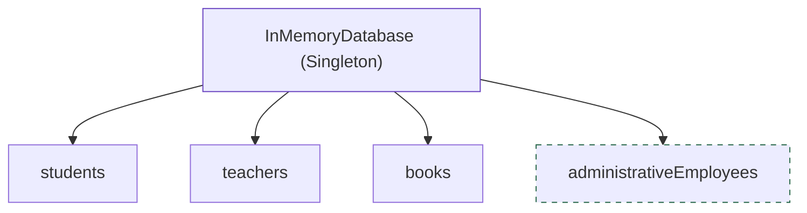

```text
InMemoryDatabase
│
├── students
├── teachers
├── books
└── administrativeEmployees
```

---

# 12. Preguntas de reflexión final

Responder con sus propias palabras:

### Fundamentos y Encapsulación

1. ¿Qué diferencia existe entre una clase y un objeto?

2. ¿Qué problema resuelve la encapsulación?

3. ¿Qué función cumple `private`?

4. ¿Por qué utilizamos getters y setters?

### Herencia

5. ¿Qué problema resuelve la herencia?

6. ¿Qué representa `Person` dentro de nuestro sistema?

7. ¿Qué significa que `Student` herede de `Person`?

8. ¿Qué función cumple `super`?

### Principio de Responsabilidad Única (SRP)

9. ¿Por qué separamos `Student` y `StudentRepository`?

10. ¿Qué responsabilidad tiene cada una de estas clases?

11. ¿Qué significa Single Responsibility Principle?

### Colecciones y Base de Datos en Memoria

12. ¿Qué diferencia existe entre una `List` y un `HashMap`?

13. ¿Por qué utilizamos el ID como clave del `HashMap`?

14. ¿Por qué nuestra base de datos utiliza diferentes colecciones para estudiantes, docentes y libros?

15. ¿Qué ventaja obtenemos al organizar los datos como “tablas”?

16. ¿Qué significa que los datos estén almacenados en memoria?

17. ¿Qué ocurre con los datos cuando finaliza el programa?

### Patrón Singleton

18. ¿Qué problema aparece si existen dos instancias de `InMemoryDatabase`?

19. ¿Qué problema intenta solucionar Singleton?

20. ¿Cómo podemos comprobar que dos variables apuntan a la misma instancia?

### Principio Open/Closed (OCP)

21. ¿Qué significa Open/Closed Principle?

22. ¿Cómo conseguimos extender nuestro sistema agregando `Book` sin modificar completamente la estructura existente?

---

# 13. Restricciones de la práctica

Para mantener el enfoque en los fundamentos de POO, en esta práctica no se utilizarán:

| ❌ Elementos No Permitidos | ✔️ Elementos Permitidos y Requeridos |
| :--- | :--- |
| Interfaces | Clases y Objetos estándar |
| Clases abstractas | Atributos privados y métodos de acceso (`getters`/`setters`) |
| Polimorfismo | Herencia directa mediante `extends` |
| Métodos abstractos | Constructores con delegación mediante `super(...)` |
| `@Override` | Principio de Responsabilidad Única (SRP) |
| JDBC | Simulación de base de datos en memoria |
| MySQL / PostgreSQL | Colecciones Java: `List`, `Map` y `HashMap` |
| Frameworks externos | Patrón Singleton artesanal en Java puro |

```text
❌ Interfaces
❌ Clases abstractas
❌ Polimorfismo
❌ Métodos abstractos
❌ @Override
❌ JDBC
❌ MySQL
❌ PostgreSQL
❌ Frameworks
```

El almacenamiento será únicamente en memoria:

```text
Java Collections
       │
       ├── List
       └── Map / HashMap
```

---

# 14. Resultado esperado

El estudiante debe comprender que el sistema no fue construido completamente desde el principio.

La solución evolucionó de acuerdo con las necesidades:

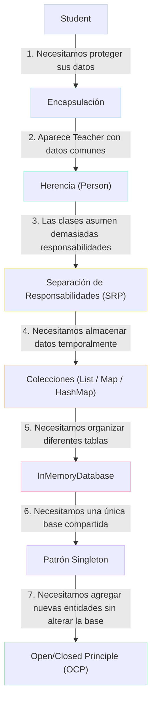